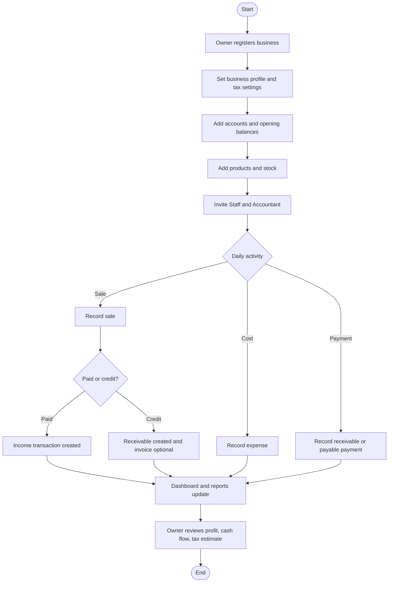
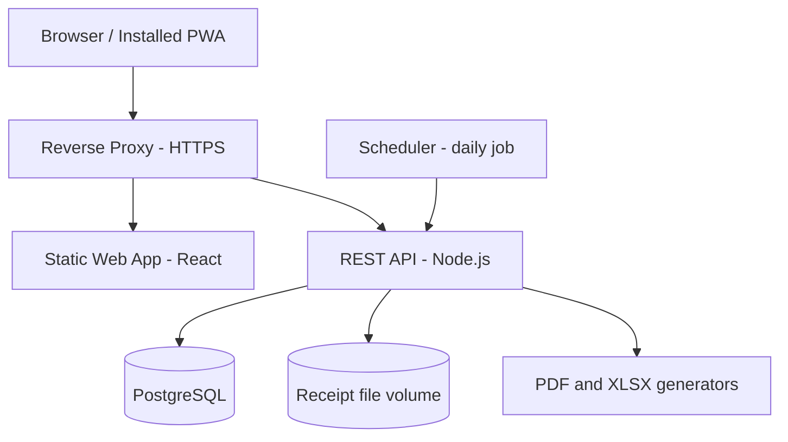

# PRODUCT REQUIREMENTS DOCUMENT (PRD)

> **Catatan:** Versi sederhana berbeda dari dokumen ini. Lihat `Docs/superpowers/specs/2026-11-04-usahaku-sederhana-design.md`.

**Product Name:** usahaku (bookkeeping and finance app for UMKM)  
**Document Version:** 1.0  
**Status:** Draft  
**Date:** 04 November 2026  
**Product Owner:** [To be decided: product owner name]  

---

# 1. Overview

## 1.1 Background
Most UMKM (micro, small, and medium enterprises) in Indonesia keep their books in paper notebooks, chat messages, or memory. Business money and personal money often sit in the same wallet or bank account. The owner usually knows how much cash is on hand but not how much profit the business made, which customers still owe money, or which supplier bills are due this week. Tax obligations, such as the final income tax for UMKM, are then estimated by guesswork.

uangku, a personal finance app, already solves the recording, budgeting, reporting, and import problems for individuals. A business needs the same foundation plus a few things that personal finance does not cover: sales with products and stock, receivables and payables, invoices, several users with different permissions, and a profit and loss view. usahaku adapts the uangku feature set to those needs.

## 1.2 Product Goals
- Let an owner record a sale or expense in under 30 seconds on a phone.
- Show the real profit of the business for any period without manual calculation.
- Make unpaid customer invoices and supplier bills visible before they become overdue.
- Give the owner a monthly estimate of final income tax from recorded turnover.
- Let staff record sales without seeing the owner's profit and cost data.

## 1.3 Product Description
usahaku is a web application, installable as a PWA, for owners of small shops, food stalls, workshops, and service businesses. It records income, expenses, and transfers across cash, bank, and e-wallet accounts. It records sales by product with automatic stock reduction, tracks receivables and payables per contact, issues invoices as PDF, and produces profit and loss, cash flow, and receivable aging reports. Three roles (Owner, Staff, Accountant) share one business account. All data is stored on a server, so the owner can switch phones and staff can work from their own devices.

## 1.4 Target Users
| Role | Description | Responsibilities |
|---|---|---|
| Owner | The business owner. Creates the business account and has full access. Acts as the admin of the business. | Configures the business, manages users, accounts, products, budgets, and settings, reviews reports and tax estimates. |
| Staff | A cashier or shop assistant working for the owner. | Records sales, expenses, and receivable payments. Views products and contacts. Cannot see profit reports or change settings. |
| Accountant | An external or internal bookkeeper with read access. | Reviews transactions and reports, exports data, and reads the audit log. Cannot create or change records. |

## 1.5 Product Scope

### In Scope
- Multi-user business account with three roles.
- Cash, bank, and e-wallet accounts in IDR, with transfers between them.
- Income, expense, and transfer recording with categories, tags, receipt photos, and auto-categorization rules.
- Product catalog with stock tracking and sales recording.
- Customer and supplier contacts, receivables, payables, and partial payments.
- Invoice creation from a sale and PDF export.
- Monthly budgets and recurring transactions.
- Dashboard, profit and loss, cash flow, sales by product, expense by category, and receivable aging reports, with CSV, XLSX, and PDF export.
- Final income tax (PPh Final UMKM) estimate.
- CSV and XLSX import with column mapping and duplicate detection.
- Full data export and audit log.

### Out of Scope
- Bank, e-wallet, or marketplace integrations and automatic notification reading.
- Payment gateway and online payment collection.
- Payroll and employee attendance.
- Full double-entry accounting, chart of accounts, and journal entries.
- Official tax filing, e-Faktur, and VAT (PPN) calculation.
- Multi-currency and multi-branch businesses.
- Offline-first operation. The app needs an internet connection to save data.
- OCR on receipt photos. Photos are attachments only.

---

# 2. Requirements

## 2.1 Functional Requirements

| ID | Requirement | Description | Priority |
|---|---|---|---|
| FR-001 | Authentication | Users register a business, log in, log out, and change their password. | High |
| FR-002 | User & Role Management | The Owner creates, edits, and deactivates Staff and Accountant users. | High |
| FR-003 | Business Settings | The Owner edits the business profile, period start day, taxpayer type, and tax rate. | Medium |
| FR-004 | Account Management | The Owner manages cash, bank, and e-wallet accounts with opening balances. | High |
| FR-005 | Transaction Recording | Users record income, expense, and transfer transactions with an optional receipt photo. | High |
| FR-006 | Categories, Tags & Auto-Rules | Users organize transactions with categories, tags, and keyword rules that fill the category automatically. | Medium |
| FR-007 | Product & Stock Management | The Owner manages products and stock, and anyone with access can see stock levels. | High |
| FR-008 | Sales Recording | Users record a sale with items, discount, and payment type (paid or credit). | High |
| FR-009 | Contact Management | Users manage customers and suppliers. | Medium |
| FR-010 | Receivables & Payables | The system tracks money owed to and by the business, with partial payments and overdue status. | High |
| FR-011 | Invoicing | Users create an invoice from a sale and export it as PDF. | Medium |
| FR-012 | Budgets | The Owner sets a monthly budget per expense category and sees usage. | Medium |
| FR-013 | Recurring Transactions | The Owner schedules daily, weekly, or monthly transactions that post automatically. | Medium |
| FR-014 | Dashboard | Users see a summary of sales, expenses, balances, receivables, payables, and low stock. | High |
| FR-015 | Financial Reports & Export | The Owner and Accountant view reports and export them as CSV, XLSX, or PDF. | High |
| FR-016 | Tax Estimate | The system estimates monthly final income tax from recorded turnover. | Medium |
| FR-017 | Data Import | The Owner imports transactions from CSV or XLSX with column mapping and duplicate detection. | Medium |
| FR-018 | Data Export | The Owner and Accountant download all business data as a ZIP of CSV files. | Low |
| FR-019 | Audit Log | The system records who created, changed, or deleted data, and the Owner and Accountant can read it. | Medium |

## 2.2 Non-Functional Requirements

| ID | Category | Requirement | Description |
|---|---|---|---|
| NFR-001 | Security | Authentication & Authorization | Every API endpoint except register and login requires a valid session. Role checks run on the backend. |
| NFR-002 | Performance | Response Time | 95% of list and save requests complete in under 500 ms. Reports over 50,000 transactions complete in under 3 seconds. |
| NFR-003 | Scalability | Data Volume | One business can hold 200,000 transactions without breaking the response time targets. |
| NFR-004 | Reliability | Data Integrity | Money is stored as integer rupiah. Multi-table writes (a sale with its stock and payment records) succeed or fail as one unit. |
| NFR-005 | Usability | Mobile-First | Core flows work on a 360 px wide screen with touch targets of at least 44 px. |
| NFR-006 | Availability | Backup | The database is backed up daily and backups are kept for 30 days. |
| NFR-007 | Privacy | Personal Data Protection | Customer and user personal data is stored only to run the service and can be exported or deleted on request, in line with Indonesian Law No. 27 of 2022 on Personal Data Protection. |

## 2.3 Business Rules

| ID | Business Rule | Description |
|---|---|---|
| BR-001 | Money as integer rupiah | All amounts are whole rupiah stored as integers. Decimals are rejected. |
| BR-002 | Transfers are neutral | A transfer needs two different accounts. It moves balance but is never counted as income or expense in any report. |
| BR-003 | Account balance | Balance equals opening balance plus income, minus expense, plus incoming transfers, minus outgoing transfers. An account with transactions can be archived but not deleted. |
| BR-004 | Stock never goes negative | For a product with stock tracking on, a sale that exceeds current stock is rejected. Products with tracking off have no stock limit. |
| BR-005 | Void, not delete | A sale or receivable payment is voided, not deleted. Voiding a sale restores stock and reverses its payment transaction. |
| BR-006 | Invoice numbering | Invoice numbers follow `INV/YYYY/NNNN`, increase by one per business per year, and are never reused. |
| BR-007 | Debt status | A receivable or payable is Open (no payment), Partial (some paid), or Paid (fully paid). It is shown as Overdue when the due date has passed and the balance is above zero. |
| BR-008 | Payments create cash movement | Paying a receivable creates an income transaction on the chosen account. Paying a payable creates an expense transaction. Neither payment counts toward profit and loss. |
| BR-009 | Reporting period | A reporting period starts on the business's period start day (1 to 28), so "this period" matches how the owner thinks about a month. |
| BR-010 | Profit recognition | Sales revenue is recognized on the sale date, whether paid or on credit. A payable bill is recognized as an expense on its issue date. Cost of goods sold equals quantity sold times the cost price saved on the sale item. Inventory purchases are excluded from expenses. |
| BR-011 | Cost price visibility | Cost price, profit, and margin are visible only to Owner and Accountant. |
| BR-012 | Tax rate | The final income tax rate defaults to 0.5% of gross turnover. For an individual taxpayer, turnover up to Rp500,000,000 per tax year is not taxed. Both values are editable in business settings. |
| BR-013 | Staff edit window | Staff can edit their own transactions for 24 hours after creation. After that only the Owner can edit. |
| BR-014 | Duplicate import | An imported row is a duplicate when its date, amount, account, and note match an existing transaction. Duplicates are skipped by default. |

## 2.4 Access Control & Permissions

| Module / Feature | Owner | Staff | Accountant |
|---|---|---|---|
| Dashboard | Full Access | Today's sales and own entries only | View |
| Business Settings | Full Access | No | View |
| User Management | Full Access | No | No |
| Accounts | Full Access | View | View |
| Transactions | Create, Edit, Delete | Create, Edit own (24 h), No Delete | View |
| Categories, Tags, Rules | Full Access | View | View |
| Products & Stock | Full Access | View (no cost price) | View |
| Sales | Create, View, Void | Create, View own | View |
| Contacts | Full Access | Create, View | View |
| Receivables & Payables | Full Access | View receivables, Record payment | View |
| Invoices | Full Access | Create, View | View |
| Budgets | Full Access | No | View |
| Recurring Transactions | Full Access | No | View |
| Reports | Full Access | No | View, Export |
| Tax Estimate | Full Access | No | View |
| Data Import | Full Access | No | No |
| Data Export | Yes | No | Yes |
| Audit Log | View | No | View |

---

# 3. Core Features

## 3.1 Authentication, Users & Business Settings (FR-001, FR-002, FR-003)

**Description:**  
A person registers a business and becomes its Owner. The Owner creates Staff and Accountant users and sets business-wide options.

**User Story:**  
As an Owner, I want to create accounts for my cashier and my bookkeeper with limited access, so that they can work without seeing data they do not need.

**Preconditions:**
- Registration needs no preconditions.
- User and settings changes need an Owner session.

**Functional Behavior:**
1. Registration creates one business and one Owner user, then logs the Owner in.
2. The Owner creates a user with name, email, role, and a temporary password.
3. A user created this way must set a new password at first login.
4. The Owner can deactivate a user. Deactivated users cannot log in and their sessions end immediately.
5. The Owner edits business name, address, phone, NPWP, taxpayer type, period start day, and tax rate.
6. Five failed logins on one email lock that account for 15 minutes.

**Input:**

| Field | Type | Required | Validation |
|---|---|---|---|
| business_name | String | Yes | 2 to 100 characters |
| name | String | Yes | 2 to 100 characters |
| email | String | Yes | Valid email, unique across the system |
| password | String | Yes | At least 8 characters, not equal to the email |
| role | Enum | Yes | `staff` or `accountant` (Owner only) |
| period_start_day | Integer | No | 1 to 28, default 1 |
| tax_rate | Decimal | No | 0 to 5 percent, default 0.5 |

**Output:**
- A logged-in session with the user's role.
- The user list with role and active status.
- The updated business profile.

**Error Handling:**
- Duplicate email returns a field error on `email`.
- Wrong credentials return one generic message that does not say which field was wrong.
- A locked account returns the remaining lock time.
- The last active Owner cannot be deactivated.

**Acceptance Criteria:**
- [ ] Given a new visitor, when they submit valid registration data, then a business and an Owner exist and the visitor is logged in.
- [ ] Given an Owner, when they create a Staff user, then that user can log in and sees only Staff menus.
- [ ] Given a deactivated user with an open session, when they send any request, then the response is 401.
- [ ] Given five failed logins, when a sixth is attempted within 15 minutes, then it is rejected even with the correct password.

## 3.2 Accounts & Transaction Recording (FR-004, FR-005)

**Description:**  
The business keeps cash, bank, and e-wallet accounts. Every money movement is recorded as income, expense, or transfer against these accounts.

**User Story:**  
As a Staff member, I want to record an expense with a photo of the receipt, so that the owner can see where the money went.

**Preconditions:**
- At least one active account exists.

**Functional Behavior:**
1. The Owner creates an account with name, type, and opening balance.
2. A user opens the "Add" drawer from any page and picks Income, Expense, or Transfer.
3. The user enters amount, date (default today), account, category, note, tags, and optionally a receipt photo.
4. The client compresses the photo to at most 1600 px on the long side before upload.
5. For a transfer the user picks a source and a different destination account. No category is needed.
6. The system suggests a category from the auto-categorization rules while the user types the note.
7. The user can edit a transaction within the permission rules, or mark it as excluded from reports.
8. The list can be filtered by date range, account, type, category, tag, and text search.

**Input:**

| Field | Type | Required | Validation |
|---|---|---|---|
| type | Enum | Yes | `income`, `expense`, `transfer` |
| amount | Integer | Yes | Greater than 0, at most 999,999,999,999 |
| account_id | UUID | Yes | Active account of this business |
| transfer_account_id | UUID | Transfer only | Active account, different from `account_id` |
| category_id | UUID | Income and expense | Category of the same type |
| occurred_on | Date | Yes | Valid date, not more than 1 year in the future |
| note | String | No | Up to 500 characters |
| tags | String[] | No | Up to 10 tags, 30 characters each |
| receipt | File | No | JPEG, PNG, or WebP, up to 5 MB after compression |

**Output:**
- The saved transaction with the updated account balance.
- A paginated, filterable transaction list with totals for the filtered range.

**Error Handling:**
- Invalid fields return per-field messages and nothing is saved.
- An upload failure keeps the form data and lets the user retry the upload only.
- An empty list shows an empty state with a button to add the first transaction.
- Deleting an account that has transactions is refused with a message to archive it.

**Acceptance Criteria:**
- [ ] Given an account with balance Rp1,000,000, when an expense of Rp250,000 is saved, then the balance shows Rp750,000.
- [ ] Given a transfer of Rp100,000 from Cash to Bank, when saved, then Cash drops by Rp100,000, Bank rises by Rp100,000, and no report shows income or expense for it.
- [ ] Given a Staff user, when they edit their own transaction after 24 hours, then the request is rejected.
- [ ] Given a 6 MB photo that cannot be compressed under 5 MB, when uploading, then the user sees an error and the transaction is not blocked.

## 3.3 Categories, Tags & Auto-Categorization (FR-006)

**Description:**  
Categories group transactions for reports and budgets. Rules fill the category from keywords in the note.

**User Story:**  
As an Owner, I want notes like "listrik" to land in the Utilities category automatically, so that I do not pick a category every time.

**Preconditions:**
- Owner session for changes.

**Functional Behavior:**
1. A new business starts with default categories for income (Sales, Other Income) and expense (Inventory Purchase, Rent, Utilities, Salaries, Transport, Marketing, Supplies, Tax, Other).
2. The Owner adds, renames, and archives categories, including one level of subcategories.
3. Each expense category has a profit-and-loss group: operating expense, other expense, or inventory (excluded from profit).
4. The Owner creates rules of the form "if the note contains KEYWORD, use category X". The highest-priority matching rule wins.
5. A test box shows which category a sample note would get.

**Input:**

| Field | Type | Required | Validation |
|---|---|---|---|
| name | String | Yes | 1 to 60 characters, unique within type and parent |
| type | Enum | Yes | `income` or `expense` |
| pl_group | Enum | Expense only | `operating_expense`, `other_expense`, `inventory` |
| keyword | String | Rules | 2 to 50 characters, case-insensitive |
| priority | Integer | Rules | 1 to 100 |

**Output:**
- Category tree with usage counts.
- Rule list and the category match for a test note.

**Error Handling:**
- A category with transactions cannot be deleted; it can be archived.
- A rule that points to an archived category is rejected.
- No matching rule leaves the category empty for the user to choose.

**Acceptance Criteria:**
- [ ] Given a rule "listrik" to Utilities, when a user types "bayar listrik toko", then Utilities is suggested.
- [ ] Given two matching rules, when the note is tested, then the one with the higher priority is returned.
- [ ] Given a category with 10 transactions, when the Owner tries to delete it, then it is refused and archiving is offered.

## 3.4 Products & Stock (FR-007)

**Description:**  
A catalog of what the business sells, with price, cost, and optional stock tracking.

**User Story:**  
As an Owner, I want to see which products are running low, so that I can restock before I lose sales.

**Preconditions:**
- Owner session for changes.

**Functional Behavior:**
1. The Owner creates a product with SKU (optional), name, unit, selling price, cost price, and a stock tracking switch.
2. With tracking on, the Owner sets opening stock and a low-stock threshold.
3. The Owner records a restock or manual adjustment with a reason. Each change writes a stock movement.
4. A restock can optionally create an expense transaction in the Inventory Purchase category.
5. The product list shows stock, a low-stock badge, and (for Owner and Accountant) margin.
6. A product can be deactivated. It disappears from the sales picker but stays in history.

**Input:**

| Field | Type | Required | Validation |
|---|---|---|---|
| name | String | Yes | 1 to 120 characters, unique per business |
| sku | String | No | Up to 40 characters, unique per business |
| unit | String | Yes | Up to 20 characters (pcs, kg, porsi) |
| sell_price | Integer | Yes | 0 or more |
| cost_price | Integer | Yes | 0 or more |
| track_stock | Boolean | Yes | Default true |
| stock_qty | Decimal | If tracked | 0 or more, up to 3 decimals |
| low_stock_threshold | Decimal | No | 0 or more |

**Output:**
- Product list with stock and low-stock flags.
- Stock movement history per product.

**Error Handling:**
- A duplicate name or SKU returns a field error.
- An adjustment that would make stock negative is rejected.
- Products with no movement history show an empty history state.

**Acceptance Criteria:**
- [ ] Given a product with stock 10 and threshold 5, when stock drops to 5, then the low-stock badge appears.
- [ ] Given a restock of 20 with "create expense" on, when saved, then stock rises by 20 and an Inventory Purchase expense exists.
- [ ] Given a Staff user, when they open a product, then cost price and margin are not in the response.

## 3.5 Sales Recording (FR-008)

**Description:**  
A fast way to record what was sold, to whom, and whether it was paid.

**User Story:**  
As a Staff member, I want to pick products and quantities and save the sale in a few taps, so that customers do not wait.

**Preconditions:**
- At least one active product, or a free-text item.
- For a paid sale, at least one active account.

**Functional Behavior:**
1. The user adds items by product (price filled in, editable) or as a free-text line with a price.
2. The user enters an optional discount in rupiah and an optional customer.
3. The user chooses "Paid" and the receiving account, or "Credit" and a due date. Credit needs a customer.
4. On save, the system stores the sale and its items with the cost price at that moment.
5. Stock drops for tracked products.
6. A paid sale creates an income transaction on the chosen account. A credit sale creates a receivable.
7. The Owner can void a sale, which restores stock and reverses the payment or cancels the receivable.

**Input:**

| Field | Type | Required | Validation |
|---|---|---|---|
| items | Array | Yes | 1 to 100 lines |
| items[].product_id | UUID | No | Active product; omit for free-text |
| items[].description | String | Free-text only | 1 to 120 characters |
| items[].qty | Decimal | Yes | Greater than 0, up to 3 decimals |
| items[].unit_price | Integer | Yes | 0 or more |
| discount | Integer | No | 0 to subtotal |
| payment_type | Enum | Yes | `paid` or `credit` |
| account_id | UUID | Paid only | Active account |
| contact_id | UUID | Credit only | Customer or both |
| due_date | Date | Credit only | On or after the sale date |
| sale_date | Date | Yes | Default today |

**Output:**
- The saved sale with total, payment status, and links to its transaction or receivable.
- Sales list filtered by date, customer, and payment status.

**Error Handling:**
- Quantity above stock returns an error naming the product and the available quantity.
- Discount above subtotal is rejected.
- Credit without a customer is rejected.
- If any step of the save fails, no part of the sale is stored.

**Acceptance Criteria:**
- [ ] Given a product with stock 10, when a sale of 3 is saved, then stock is 7.
- [ ] Given a credit sale of Rp500,000, when saved, then a receivable of Rp500,000 exists for that customer and no income transaction is created.
- [ ] Given a paid sale, when the Owner voids it, then stock returns and the income transaction is reversed.
- [ ] Given stock 2, when a sale of 3 is submitted, then it is rejected and nothing changes.

## 3.6 Contacts, Receivables & Payables (FR-009, FR-010)

**Description:**  
Contacts hold customers and suppliers. Receivables are money customers owe. Payables are money the business owes suppliers.

**User Story:**  
As an Owner, I want a list of overdue customers with amounts, so that I know who to remind today.

**Preconditions:**
- Owner session to manage everything. Staff can create contacts and record receivable payments.

**Functional Behavior:**
1. A contact has name, type (customer, supplier, both), phone, email, address, and notes.
2. Credit sales create receivables automatically. The Owner can also add a manual receivable or a payable bill with contact, amount, issue date, due date, and category.
3. A payment is recorded against one debt with date, amount, and account. It may be partial.
4. The system creates the matching income transaction (receivable) or expense transaction (payable), per BR-008.
5. Status updates to Partial or Paid. Overdue is shown by comparing the due date with today.
6. The list shows totals per contact, filter by type and status, and sorts by due date.
7. A voided payment restores the balance.

**Input:**

| Field | Type | Required | Validation |
|---|---|---|---|
| name | String | Yes | 1 to 120 characters |
| contact type | Enum | Yes | `customer`, `supplier`, `both` |
| debt type | Enum | Yes | `receivable` or `payable` |
| amount | Integer | Yes | Greater than 0 |
| due_date | Date | Yes | On or after the issue date |
| payment amount | Integer | Yes | Greater than 0 and at most the remaining balance |
| payment account | UUID | Yes | Active account |

**Output:**
- Contact list with outstanding balance.
- Debt list with status, remaining balance, and days overdue.
- Payment history per debt.

**Error Handling:**
- A payment above the remaining balance is rejected.
- A contact with open debts cannot be archived.
- No debts shows an empty state with a short explanation.

**Acceptance Criteria:**
- [ ] Given a receivable of Rp1,000,000, when a payment of Rp400,000 is recorded, then the status is Partial and the balance is Rp600,000.
- [ ] Given a receivable due yesterday with a balance, when the list loads, then it is flagged Overdue.
- [ ] Given a receivable payment, when the profit and loss report runs, then that payment adds nothing to revenue.

## 3.7 Invoicing (FR-011)

**Description:**  
An invoice is the printable document for a sale.

**User Story:**  
As an Owner, I want to send a professional invoice PDF to a customer, so that they know what and when to pay.

**Preconditions:**
- A sale exists and has no invoice yet.
- Business name and address are set.

**Functional Behavior:**
1. The user opens a sale and chooses "Create invoice".
2. The system assigns the next number (BR-006) and stores issue date, due date, and notes.
3. The user downloads the PDF, which shows business details, customer, items, discount, total, payment status, and the bank account to pay into if the Owner added one in settings.
4. Invoice status is Draft, Issued, Paid, or Void. Paid follows the linked receivable automatically.
5. Voiding a sale voids its invoice. Its number stays used.

**Input:**

| Field | Type | Required | Validation |
|---|---|---|---|
| sale_id | UUID | Yes | Sale of this business without an invoice |
| issue_date | Date | Yes | Valid date |
| due_date | Date | No | On or after the issue date |
| notes | String | No | Up to 500 characters |

**Output:**
- The invoice record with its number.
- A PDF file.

**Error Handling:**
- A second invoice for the same sale is rejected.
- Missing business address returns a message linking to settings.
- A PDF generation failure returns an error and the invoice record stays.

**Acceptance Criteria:**
- [ ] Given the first invoice of 2026, when created, then its number is `INV/2026/0001`.
- [ ] Given a credit sale with an invoice, when the receivable is fully paid, then the invoice status becomes Paid.
- [ ] Given a voided invoice, when a new one is created, then the new number does not reuse the voided one.

## 3.8 Budgets & Recurring Transactions (FR-012, FR-013)

**Description:**  
Budgets cap spending per category for a period. Recurring rules post regular transactions such as rent automatically.

**User Story:**  
As an Owner, I want rent and internet to be recorded by themselves every month, so that my reports stay complete.

**Preconditions:**
- Owner session. At least one account and expense category.

**Functional Behavior:**
1. The Owner sets an amount per expense category for a period (based on the period start day).
2. Budget view shows used amount, percentage, remaining amount, remaining per day, and flags categories over budget.
3. The Owner creates a recurring rule with type, account, category, amount, frequency (daily, weekly, monthly), start date, and optional end date.
4. A daily job at 00:05 (Asia/Jakarta) posts every rule whose next run date is today or earlier, once per missed date, then moves the next run date forward.
5. The Owner can post a rule now, pause it, or end it.

**Input:**

| Field | Type | Required | Validation |
|---|---|---|---|
| period | Date | Yes | First day of a period |
| items[].category_id | UUID | Yes | Expense category |
| items[].amount | Integer | Yes | Greater than 0 |
| frequency | Enum | Rules | `daily`, `weekly`, `monthly` |
| start_on | Date | Rules | Valid date |
| end_on | Date | No | After `start_on` |

**Output:**
- Budget summary with usage per category.
- Recurring rule list with next run date and last run result.

**Error Handling:**
- A budget for a period that already has one updates it instead of creating a second.
- A monthly rule on day 29 to 31 posts on the last day of shorter months.
- A failed posting is logged and retried at the next run; it does not stop other rules.

**Acceptance Criteria:**
- [ ] Given a budget of Rp1,000,000 for Rent and an expense of Rp1,200,000, when the summary loads, then Rent shows 120% and over budget.
- [ ] Given a monthly rule starting on the 31st, when February runs, then it posts on 28 or 29 February.
- [ ] Given a paused rule, when the daily job runs, then nothing is posted for it.

## 3.9 Dashboard & Financial Reports (FR-014, FR-015)

**Description:**  
The dashboard gives a quick picture. Reports give detail for a chosen period and can be exported.

**User Story:**  
As an Owner, I want to see profit for last month and compare it with this month, so that I know whether the business is improving.

**Preconditions:**
- Owner or Accountant session for reports. Staff see a limited dashboard.

**Functional Behavior:**
1. The dashboard shows today's sales, period revenue, period expenses, estimated net profit, total account balance, receivables and payables outstanding, overdue count, a daily revenue versus expense chart, top 5 products, expense by category, low-stock products, and recent transactions.
2. Reports have a period filter: this period, last period, last 3 periods, this year, or a custom range.
3. Profit and loss: revenue, cost of goods sold, gross profit, operating expenses, other income and expense, net profit, with optional comparison to the previous period.
4. Cash flow: money in and out per account and per category.
5. Sales by product: quantity, revenue, and margin.
6. Expense by category with percentage of total.
7. Receivable aging in buckets 0 to 30, 31 to 60, 61 to 90, and over 90 days.
8. Each report exports to CSV, XLSX, and PDF with the same filters.

**Input:**

| Field | Type | Required | Validation |
|---|---|---|---|
| from | Date | Yes | Valid date |
| to | Date | Yes | On or after `from`, at most 5 years apart |
| compare | Boolean | No | Compare with the previous equal-length range |
| format | Enum | Export | `csv`, `xlsx`, `pdf` |

**Output:**
- Dashboard cards and charts.
- Report tables with totals.
- A downloadable file.

**Error Handling:**
- An invalid range returns a field error.
- A range with no data shows an empty state, not zeros without explanation.
- Export of a very large range runs on the server and fails with a message if it exceeds 60 seconds.

**Acceptance Criteria:**
- [ ] Given sales of Rp2,000,000 with cost Rp1,200,000 and operating expenses Rp300,000, when the P&L runs, then gross profit is Rp800,000 and net profit is Rp500,000.
- [ ] Given a transfer in the range, when any report runs, then the transfer is not included.
- [ ] Given a Staff session, when they request a report, then the response is 403.
- [ ] Given a report on screen, when exported to XLSX, then the file totals equal the screen totals.

## 3.10 Tax Estimate (FR-016)

**Description:**  
Estimates final income tax for UMKM from recorded turnover so the owner can set money aside.

**User Story:**  
As an Owner, I want to see how much final tax I probably owe each month, so that I am not surprised at payment time.

**Preconditions:**
- Taxpayer type and tax rate are set in business settings.

**Functional Behavior:**
1. The Owner picks a calendar year.
2. For each month the system sums gross turnover: net sales revenue plus other business income.
3. For an individual taxpayer, the first Rp500,000,000 of cumulative turnover in the year is untaxed (threshold editable). A company has no threshold.
4. Monthly tax equals the rate times the taxable turnover added in that month.
5. The page shows month, turnover, cumulative turnover, taxable turnover, and estimated tax, with a note that this is an estimate and not a tax return.
6. The Owner can record the payment as an expense in the Tax category with one click.

**Input:**

| Field | Type | Required | Validation |
|---|---|---|---|
| year | Integer | Yes | 2020 to the current year |

**Output:**
- A 12-month table and a year total.

**Error Handling:**
- Missing taxpayer type shows a prompt to complete settings.
- A year with no turnover shows zeros with an explanation.

**Acceptance Criteria:**
- [ ] Given an individual taxpayer with turnover of Rp40,000,000 per month at 0.5%, when the year is computed, then cumulative turnover reaches Rp480,000,000 in December, which is under the threshold, so all 12 months show zero tax.
- [ ] Given an individual taxpayer with turnover of Rp60,000,000 per month, when computed, then tax in month 9 is 0.5% of Rp40,000,000, and months 10 to 12 are 0.5% of Rp60,000,000 each.
- [ ] Given a company taxpayer with turnover of Rp10,000,000 in a month, when computed, then tax is Rp50,000.

## 3.11 Data Import (FR-017)

**Description:**  
Brings in transactions from existing spreadsheets or bank statements.

**User Story:**  
As an Owner, I want to upload last year's spreadsheet, so that my history is in one place.

**Preconditions:**
- Owner session and at least one account.

**Functional Behavior:**
1. The Owner uploads a CSV or XLSX file up to 5 MB and 5,000 rows.
2. The system shows a preview and the Owner maps columns to date, amount, type or sign, note, and category.
3. The Owner picks the destination account and a fallback category for rows without one.
4. The system marks rows that are invalid or duplicate (BR-014) in the preview.
5. On confirm, valid rows are saved in one batch. Duplicates are skipped unless the Owner chooses to include them.
6. The result shows counts of imported, skipped, and failed rows.

**Input:**

| Field | Type | Required | Validation |
|---|---|---|---|
| file | File | Yes | CSV or XLSX, up to 5 MB, up to 5,000 rows |
| column mapping | Object | Yes | Date and amount mapped |
| account_id | UUID | Yes | Active account |
| default_category_id | UUID | Yes | Category matching each row's type |

**Output:**
- A row-level preview with status.
- An import summary.

**Error Handling:**
- An unreadable file returns a clear message and nothing is saved.
- Rows with invalid dates or amounts are listed with the reason and skipped.
- If the batch save fails, no row from that batch is stored.

**Acceptance Criteria:**
- [ ] Given a file with 100 valid rows, when confirmed, then 100 transactions exist.
- [ ] Given a row identical to an existing transaction, when previewed, then it is marked duplicate and skipped on import.
- [ ] Given a file with 5,001 rows, when uploaded, then it is rejected with the row limit message.

## 3.12 Data Export & Audit Log (FR-018, FR-019)

**Description:**  
The Owner and Accountant can take all data out. Every change to business data leaves a trace.

**User Story:**  
As an Accountant, I want to see who changed a transaction and when, so that I can trust the numbers.

**Preconditions:**
- Owner or Accountant session.

**Functional Behavior:**
1. Data export builds a ZIP with one CSV per entity (transactions, accounts, categories, products, stock movements, sales, sale items, contacts, debts, payments, invoices). Receipt files are not included.
2. The system writes an audit entry for create, update, delete, void, login, failed login, and role change events, with user, time, entity, and changed fields.
3. The audit log list filters by user, entity, action, and date range, and is read-only.
4. Audit entries are kept for 2 years.

**Input:**

| Field | Type | Required | Validation |
|---|---|---|---|
| from, to | Date | No | Valid range |
| user_id, entity, action | String | No | Known values |

**Output:**
- A ZIP file download.
- A paginated audit log.

**Error Handling:**
- Export that exceeds 60 seconds fails with a message and can be retried.
- An empty audit result shows an empty state.

**Acceptance Criteria:**
- [ ] Given an edited transaction, when the audit log is opened, then an entry shows the user, time, and the old and new values of the changed fields.
- [ ] Given a Staff session, when they request the export or the audit log, then the response is 403.
- [ ] Given an export, when opened, then every CSV has a header row and UTF-8 encoding.

---

# 4. User Flow

## 4.1 Main User Flow

## 4.2 Role-Based User Flow

### Owner Flow
- Register, set business details, period start day, and tax rate.
- Create accounts, categories, products, and users.
- Review the dashboard, approve or void sales, and follow up on overdue receivables.
- Run reports, check the tax estimate, and export data.

### Staff Flow
- Log in and open the Add drawer.
- Record sales and expenses, attach receipt photos.
- Record payments received from customers.
- Check product stock before promising an item.

### Accountant Flow
- Log in and open Reports.
- Review transactions, reports, and the audit log.
- Export reports and the full data ZIP.

## 4.3 Exception & Alternative Flow
- **Out of stock:** the sale is rejected with the available quantity. The user lowers the quantity or the Owner records a restock first.
- **Customer pays in parts:** each payment is recorded separately and the status moves from Open to Partial to Paid.
- **Wrong sale entered:** the Owner voids it. Stock, cash, and receivable effects are reversed and the audit log keeps both versions.
- **Staff leaves the business:** the Owner deactivates the user. Their past records stay.
- **Lost connection while saving:** the form keeps its data and shows a retry button. Nothing is stored locally for later sync.
- **Import has duplicates:** duplicates are skipped unless the Owner includes them.

---

# 5. Architecture

## 5.1 System Architecture

The web app is a single-page React application served as static files. It calls a Node.js REST API over HTTPS. The API owns all business logic, talks to PostgreSQL, stores receipt photos on a disk volume, and runs the daily scheduler in the same process. A reverse proxy terminates TLS.

## 5.2 Technology Stack

| Layer | Technology | Purpose |
|---|---|---|
| Frontend | React 18, Vite, Tailwind CSS, React Router, Recharts | User Interface |
| Backend | Node.js 20, Express, Zod | Business Logic & API |
| Database | PostgreSQL 16 | Data Persistence |
| Authentication | Server-side sessions in an HTTP-only cookie, Argon2 password hashing | User Authentication |
| Storage | Local disk volume for receipt photos | File Management |
| Reporting | PDFKit for PDF, ExcelJS for XLSX | Invoice and report files |
| Scheduling | node-cron inside the API process | Recurring transactions |
| Deployment | Docker Compose on one VPS with Caddy as reverse proxy | Application Hosting |

## 5.3 API Design

All endpoints are under `/api` and return JSON unless noted. Lists accept `page` (default 1) and `limit` (default 25, maximum 100).

| Method | Endpoint | Description | Access |
|---|---|---|---|
| POST | /api/auth/register | Create business and Owner | Public |
| POST | /api/auth/login | Log in | Public |
| POST | /api/auth/logout | Log out | Any user |
| POST | /api/auth/change-password | Change own password | Any user |
| GET | /api/auth/me | Current user and role | Any user |
| GET | /api/users | List users | Owner |
| POST | /api/users | Create user | Owner |
| PUT | /api/users/:id | Update role or active status | Owner |
| POST | /api/users/:id/reset-password | Set a new temporary password | Owner |
| GET | /api/business | Get business settings | Owner, Accountant |
| PUT | /api/business | Update business settings | Owner |
| GET | /api/accounts | List accounts with balances | Owner, Staff, Accountant |
| POST | /api/accounts | Create account | Owner |
| PUT | /api/accounts/:id | Update account | Owner |
| POST | /api/accounts/:id/archive | Archive account | Owner |
| GET | /api/categories | List categories | Owner, Staff, Accountant |
| POST | /api/categories | Create category | Owner |
| PUT | /api/categories/:id | Update or archive category | Owner |
| GET | /api/tags | List tags | Owner, Staff, Accountant |
| GET | /api/category-rules | List rules | Owner, Accountant |
| POST | /api/category-rules | Create rule | Owner |
| PUT | /api/category-rules/:id | Update rule | Owner |
| DELETE | /api/category-rules/:id | Delete rule | Owner |
| POST | /api/category-rules/test | Test a note against rules | Owner, Staff |
| GET | /api/transactions | List with filters | Owner, Staff, Accountant |
| POST | /api/transactions | Create transaction | Owner, Staff |
| GET | /api/transactions/:id | Get transaction | Owner, Staff, Accountant |
| PUT | /api/transactions/:id | Update transaction | Owner, Staff (own, 24 h) |
| DELETE | /api/transactions/:id | Soft delete transaction | Owner |
| POST | /api/transactions/:id/receipt | Upload receipt photo | Owner, Staff |
| GET | /api/products | List products | Owner, Staff, Accountant |
| POST | /api/products | Create product | Owner |
| PUT | /api/products/:id | Update product | Owner |
| POST | /api/products/:id/stock | Restock or adjust stock | Owner |
| GET | /api/products/:id/movements | Stock movement history | Owner, Accountant |
| GET | /api/sales | List sales | Owner, Staff (own), Accountant |
| POST | /api/sales | Create sale | Owner, Staff |
| GET | /api/sales/:id | Get sale | Owner, Staff (own), Accountant |
| POST | /api/sales/:id/void | Void sale | Owner |
| GET | /api/contacts | List contacts | Owner, Staff, Accountant |
| POST | /api/contacts | Create contact | Owner, Staff |
| PUT | /api/contacts/:id | Update or archive contact | Owner |
| GET | /api/debts | List receivables and payables | Owner, Staff (receivables), Accountant |
| POST | /api/debts | Create manual debt | Owner |
| GET | /api/debts/:id | Get debt with payments | Owner, Staff (receivables), Accountant |
| POST | /api/debts/:id/payments | Record payment | Owner, Staff (receivables) |
| POST | /api/debts/:id/payments/:paymentId/void | Void payment | Owner |
| GET | /api/invoices | List invoices | Owner, Staff, Accountant |
| POST | /api/invoices | Create invoice from a sale | Owner, Staff |
| GET | /api/invoices/:id | Get invoice | Owner, Staff, Accountant |
| PUT | /api/invoices/:id | Update dates, notes, or void | Owner |
| GET | /api/invoices/:id/pdf | Download invoice PDF | Owner, Staff, Accountant |
| GET | /api/budgets/summary | Budget with usage for a period | Owner, Accountant |
| PUT | /api/budgets | Create or update budget for a period | Owner |
| GET | /api/recurring | List recurring rules | Owner, Accountant |
| POST | /api/recurring | Create rule | Owner |
| PUT | /api/recurring/:id | Update, pause, or end rule | Owner |
| POST | /api/recurring/:id/run | Post a rule now | Owner |
| GET | /api/dashboard | Dashboard data for the role | Owner, Staff, Accountant |
| GET | /api/reports/profit-loss | Profit and loss | Owner, Accountant |
| GET | /api/reports/cash-flow | Cash flow | Owner, Accountant |
| GET | /api/reports/sales-by-product | Sales by product | Owner, Accountant |
| GET | /api/reports/expense-by-category | Expense by category | Owner, Accountant |
| GET | /api/reports/receivable-aging | Receivable aging | Owner, Accountant |
| GET | /api/reports/:name/export | Export a report (`format` = csv, xlsx, pdf) | Owner, Accountant |
| GET | /api/tax/estimate | Tax estimate for a year | Owner, Accountant |
| POST | /api/import/preview | Parse a file and return a row preview | Owner |
| POST | /api/import/commit | Save the confirmed rows | Owner |
| GET | /api/export/data | Download ZIP of all data | Owner, Accountant |
| GET | /api/audit-logs | List audit entries | Owner, Accountant |

Errors use one shape: `{ "error": { "code": "VALIDATION_ERROR", "message": "...", "fields": { "amount": "..." } } }`.

## 5.4 Data Flow

1. The browser sends a request with the session cookie to the reverse proxy, which forwards `/api` to the API and everything else to the static web app.
2. The API checks the session, then the role for the endpoint, then validates the body with Zod.
3. The service layer runs the business rules inside one database transaction. A sale, for example, writes the sale, items, stock movements, and either an income transaction or a receivable together.
4. The API writes an audit entry in the same transaction.
5. Receipt photos are written to the file volume, and only the path is stored in the database.
6. Report and export requests read from PostgreSQL, build the file in memory or a temp file, and stream it back.
7. The scheduler calls the same recurring-post service at 00:05 Asia/Jakarta every day.

---

# 6. Database Schema

## 6.1 Entity Relationship Diagram (ERD)

```mermaid
erDiagram
    BUSINESSES ||--o{ USERS : has
    BUSINESSES ||--o{ ACCOUNTS : owns
    BUSINESSES ||--o{ CATEGORIES : defines
    BUSINESSES ||--o{ PRODUCTS : sells
    BUSINESSES ||--o{ CONTACTS : knows
    BUSINESSES ||--o{ SALES : records
    BUSINESSES ||--o{ BUDGETS : plans
    BUSINESSES ||--o{ RECURRING_RULES : schedules
    BUSINESSES ||--o{ CATEGORY_RULES : configures
    BUSINESSES ||--o{ AUDIT_LOGS : logs
    USERS ||--o{ SESSIONS : opens
    ACCOUNTS ||--o{ TRANSACTIONS : holds
    CATEGORIES ||--o{ TRANSACTIONS : classifies
    TRANSACTIONS ||--o{ TRANSACTION_TAGS : tagged
    TAGS ||--o{ TRANSACTION_TAGS : applied
    ATTACHMENTS ||--o| TRANSACTIONS : proves
    PRODUCTS ||--o{ SALE_ITEMS : appears_in
    PRODUCTS ||--o{ STOCK_MOVEMENTS : changes
    SALES ||--|{ SALE_ITEMS : contains
    SALES ||--o| INVOICES : documented_by
    CONTACTS ||--o{ SALES : buys
    CONTACTS ||--o{ DEBTS : owes
    DEBTS ||--o{ DEBT_PAYMENTS : paid_by
    TRANSACTIONS ||--o| DEBT_PAYMENTS : records
    BUDGETS ||--|{ BUDGET_ITEMS : splits
    CATEGORIES ||--o{ BUDGET_ITEMS : limited_by

    BUSINESSES {
        uuid id PK
        string name
        string taxpayer_type
        int period_start_day
        int tax_rate_bp
    }
    USERS {
        uuid id PK
        uuid business_id FK
        string email UK
        string role
        boolean is_active
    }
    SESSIONS {
        uuid id PK
        uuid user_id FK
        timestamp expires_at
    }
    ACCOUNTS {
        uuid id PK
        uuid business_id FK
        string name
        string type
        bigint opening_balance
        boolean is_archived
    }
    CATEGORIES {
        uuid id PK
        uuid business_id FK
        uuid parent_id FK
        string name
        string type
        string pl_group
    }
    TRANSACTIONS {
        uuid id PK
        uuid business_id FK
        uuid account_id FK
        uuid transfer_account_id FK
        uuid category_id FK
        uuid attachment_id FK
        string type
        bigint amount
        date occurred_on
        string source_type
        uuid source_id
        timestamp deleted_at
    }
    TAGS {
        uuid id PK
        uuid business_id FK
        string name
    }
    TRANSACTION_TAGS {
        uuid transaction_id FK
        uuid tag_id FK
    }
    ATTACHMENTS {
        uuid id PK
        uuid business_id FK
        string file_path
        string mime_type
    }
    PRODUCTS {
        uuid id PK
        uuid business_id FK
        string name
        bigint sell_price
        bigint cost_price
        boolean track_stock
        decimal stock_qty
    }
    STOCK_MOVEMENTS {
        uuid id PK
        uuid product_id FK
        string movement_type
        decimal qty
        uuid ref_id
    }
    CONTACTS {
        uuid id PK
        uuid business_id FK
        string name
        string type
    }
    SALES {
        uuid id PK
        uuid business_id FK
        uuid contact_id FK
        date sale_date
        bigint total
        string payment_type
        string status
    }
    SALE_ITEMS {
        uuid id PK
        uuid sale_id FK
        uuid product_id FK
        decimal qty
        bigint unit_price
        bigint unit_cost
    }
    INVOICES {
        uuid id PK
        uuid business_id FK
        uuid sale_id FK
        string number UK
        string status
    }
    DEBTS {
        uuid id PK
        uuid business_id FK
        uuid contact_id FK
        string type
        bigint amount
        bigint paid_amount
        date due_date
        string status
    }
    DEBT_PAYMENTS {
        uuid id PK
        uuid debt_id FK
        uuid transaction_id FK
        bigint amount
        date paid_on
    }
    BUDGETS {
        uuid id PK
        uuid business_id FK
        date period_start
    }
    BUDGET_ITEMS {
        uuid id PK
        uuid budget_id FK
        uuid category_id FK
        bigint amount
    }
    RECURRING_RULES {
        uuid id PK
        uuid business_id FK
        string frequency
        date next_run_on
        boolean is_active
    }
    CATEGORY_RULES {
        uuid id PK
        uuid business_id FK
        uuid category_id FK
        string keyword
        int priority
    }
    AUDIT_LOGS {
        uuid id PK
        uuid business_id FK
        uuid user_id FK
        string action
        string entity_type
        timestamp created_at
    }
```

## 6.2 Table Specification

Every table has `id UUID PK`, `created_at TIMESTAMP NOT NULL`, and (where noted) `updated_at TIMESTAMP NOT NULL`. Every business-owned table has `business_id UUID NOT NULL` referencing `businesses(id)`. The tables below list the remaining columns.

### Table: businesses

| Column | Data Type | Constraint | Description |
|---|---|---|---|
| name | VARCHAR(100) | NOT NULL | Business name |
| address | TEXT | | Printed on invoices |
| phone | VARCHAR(30) | | Contact number |
| npwp | VARCHAR(25) | | Tax ID, optional |
| taxpayer_type | VARCHAR(20) | NOT NULL | `individual` or `company` |
| period_start_day | SMALLINT | NOT NULL, CHECK 1 to 28 | Reporting period start |
| tax_rate_bp | INT | NOT NULL | Tax rate in basis points (50 = 0.5%) |
| tax_threshold | BIGINT | NOT NULL | Untaxed turnover per year for individuals |
| payment_info | TEXT | | Bank details shown on invoices |
| updated_at | TIMESTAMP | NOT NULL | Last update |

### Table: users

| Column | Data Type | Constraint | Description |
|---|---|---|---|
| name | VARCHAR(100) | NOT NULL | Full name |
| email | VARCHAR(255) | UNIQUE, NOT NULL | Login email |
| password_hash | TEXT | NOT NULL | Argon2 hash |
| role | VARCHAR(20) | NOT NULL | `owner`, `staff`, `accountant` |
| is_active | BOOLEAN | NOT NULL | Can log in |
| must_change_password | BOOLEAN | NOT NULL | True after Owner sets a temporary password |
| failed_login_count | INT | NOT NULL | Resets on success |
| locked_until | TIMESTAMP | | Login lock end |
| updated_at | TIMESTAMP | NOT NULL | Last update |

### Table: sessions

| Column | Data Type | Constraint | Description |
|---|---|---|---|
| user_id | UUID | FK users, NOT NULL | Session owner |
| token_hash | TEXT | UNIQUE, NOT NULL | SHA-256 of the cookie token |
| expires_at | TIMESTAMP | NOT NULL | 7 days after last use |

### Table: accounts

| Column | Data Type | Constraint | Description |
|---|---|---|---|
| name | VARCHAR(60) | NOT NULL | Unique per business |
| type | VARCHAR(20) | NOT NULL | `cash`, `bank`, `ewallet` |
| opening_balance | BIGINT | NOT NULL | Starting balance in rupiah |
| is_archived | BOOLEAN | NOT NULL | Hidden from pickers |
| updated_at | TIMESTAMP | NOT NULL | Last update |

### Table: categories

| Column | Data Type | Constraint | Description |
|---|---|---|---|
| parent_id | UUID | FK categories | One level of nesting |
| name | VARCHAR(60) | NOT NULL | Unique within type and parent |
| type | VARCHAR(10) | NOT NULL | `income` or `expense` |
| pl_group | VARCHAR(20) | | `operating_expense`, `other_expense`, `inventory` for expenses |
| is_archived | BOOLEAN | NOT NULL | Hidden from pickers |

### Table: transactions

| Column | Data Type | Constraint | Description |
|---|---|---|---|
| account_id | UUID | FK accounts, NOT NULL | Source account |
| transfer_account_id | UUID | FK accounts | Destination for transfers |
| type | VARCHAR(10) | NOT NULL | `income`, `expense`, `transfer` |
| amount | BIGINT | NOT NULL, CHECK > 0 | Rupiah |
| category_id | UUID | FK categories | Null for transfers |
| contact_id | UUID | FK contacts | Optional |
| occurred_on | DATE | NOT NULL | Transaction date |
| note | VARCHAR(500) | | Free text |
| attachment_id | UUID | FK attachments | Receipt photo |
| source_type | VARCHAR(30) | NOT NULL | `manual`, `sale`, `receivable_payment`, `payable_payment`, `recurring`, `import`, `restock` |
| source_id | UUID | | Related sale, payment, or rule |
| import_hash | VARCHAR(64) | | For duplicate detection |
| is_excluded | BOOLEAN | NOT NULL | Left out of reports |
| created_by | UUID | FK users, NOT NULL | Author |
| updated_at | TIMESTAMP | NOT NULL | Last update |
| deleted_at | TIMESTAMP | | Soft delete |

### Table: products

| Column | Data Type | Constraint | Description |
|---|---|---|---|
| sku | VARCHAR(40) | UNIQUE per business | Optional code |
| name | VARCHAR(120) | NOT NULL, UNIQUE per business | Product name |
| unit | VARCHAR(20) | NOT NULL | pcs, kg, porsi |
| sell_price | BIGINT | NOT NULL | Default selling price |
| cost_price | BIGINT | NOT NULL | Default cost price |
| track_stock | BOOLEAN | NOT NULL | Stock limit applies |
| stock_qty | NUMERIC(12,3) | NOT NULL, CHECK >= 0 | Current stock |
| low_stock_threshold | NUMERIC(12,3) | | Alert level |
| is_active | BOOLEAN | NOT NULL | Shown in sales picker |
| updated_at | TIMESTAMP | NOT NULL | Last update |

### Table: stock_movements

| Column | Data Type | Constraint | Description |
|---|---|---|---|
| product_id | UUID | FK products, NOT NULL | Product |
| movement_type | VARCHAR(20) | NOT NULL | `opening`, `restock`, `sale`, `void`, `adjustment` |
| qty | NUMERIC(12,3) | NOT NULL | Positive in, negative out |
| ref_id | UUID | | Sale or transaction |
| reason | VARCHAR(200) | | Required for adjustment |
| created_by | UUID | FK users | Author |

### Table: contacts

| Column | Data Type | Constraint | Description |
|---|---|---|---|
| name | VARCHAR(120) | NOT NULL | Contact name |
| type | VARCHAR(10) | NOT NULL | `customer`, `supplier`, `both` |
| phone | VARCHAR(30) | | Phone |
| email | VARCHAR(255) | | Email |
| address | TEXT | | Address |
| notes | TEXT | | Free notes |
| is_archived | BOOLEAN | NOT NULL | Hidden from pickers |

### Table: sales and sale_items

| Column | Data Type | Constraint | Description |
|---|---|---|---|
| sales.contact_id | UUID | FK contacts | Customer, required for credit |
| sales.sale_date | DATE | NOT NULL | Revenue date |
| sales.subtotal | BIGINT | NOT NULL | Sum of lines |
| sales.discount | BIGINT | NOT NULL | 0 or more, at most subtotal |
| sales.total | BIGINT | NOT NULL | Subtotal minus discount |
| sales.payment_type | VARCHAR(10) | NOT NULL | `paid` or `credit` |
| sales.account_id | UUID | FK accounts | Receiving account for paid sales |
| sales.status | VARCHAR(10) | NOT NULL | `active` or `void` |
| sales.created_by | UUID | FK users, NOT NULL | Author |
| sale_items.sale_id | UUID | FK sales, NOT NULL | Parent sale |
| sale_items.product_id | UUID | FK products | Null for free-text lines |
| sale_items.description | VARCHAR(120) | NOT NULL | Item name at sale time |
| sale_items.qty | NUMERIC(12,3) | NOT NULL, CHECK > 0 | Quantity |
| sale_items.unit_price | BIGINT | NOT NULL | Price at sale time |
| sale_items.unit_cost | BIGINT | NOT NULL | Cost at sale time |

### Table: debts and debt_payments

| Column | Data Type | Constraint | Description |
|---|---|---|---|
| debts.type | VARCHAR(12) | NOT NULL | `receivable` or `payable` |
| debts.contact_id | UUID | FK contacts, NOT NULL | Other party |
| debts.source_type | VARCHAR(10) | NOT NULL | `sale` or `manual` |
| debts.source_id | UUID | | Sale id |
| debts.category_id | UUID | FK categories | For payable bills |
| debts.issue_date | DATE | NOT NULL | Recognition date |
| debts.due_date | DATE | NOT NULL | Due date |
| debts.amount | BIGINT | NOT NULL, CHECK > 0 | Original amount |
| debts.paid_amount | BIGINT | NOT NULL | Sum of active payments |
| debts.status | VARCHAR(10) | NOT NULL | `open`, `partial`, `paid`, `void` |
| debt_payments.debt_id | UUID | FK debts, NOT NULL | Debt |
| debt_payments.transaction_id | UUID | FK transactions, NOT NULL | Cash movement |
| debt_payments.amount | BIGINT | NOT NULL, CHECK > 0 | Payment |
| debt_payments.paid_on | DATE | NOT NULL | Payment date |
| debt_payments.is_void | BOOLEAN | NOT NULL | Voided payment |

### Table: invoices

| Column | Data Type | Constraint | Description |
|---|---|---|---|
| sale_id | UUID | FK sales, UNIQUE, NOT NULL | One invoice per sale |
| number | VARCHAR(30) | UNIQUE per business | `INV/YYYY/NNNN` |
| issue_date | DATE | NOT NULL | Issue date |
| due_date | DATE | | Due date |
| status | VARCHAR(10) | NOT NULL | `draft`, `issued`, `paid`, `void` |
| notes | VARCHAR(500) | | Printed notes |

### Table: budgets, budget_items, recurring_rules, category_rules

| Column | Data Type | Constraint | Description |
|---|---|---|---|
| budgets.period_start | DATE | NOT NULL, UNIQUE per business | First day of the period |
| budget_items.budget_id | UUID | FK budgets, NOT NULL | Parent budget |
| budget_items.category_id | UUID | FK categories, NOT NULL | Expense category |
| budget_items.amount | BIGINT | NOT NULL, CHECK > 0 | Limit |
| recurring_rules.type | VARCHAR(10) | NOT NULL | `income` or `expense` |
| recurring_rules.account_id | UUID | FK accounts, NOT NULL | Account |
| recurring_rules.category_id | UUID | FK categories, NOT NULL | Category |
| recurring_rules.amount | BIGINT | NOT NULL, CHECK > 0 | Amount |
| recurring_rules.frequency | VARCHAR(10) | NOT NULL | `daily`, `weekly`, `monthly` |
| recurring_rules.start_on | DATE | NOT NULL | Start |
| recurring_rules.end_on | DATE | | Optional end |
| recurring_rules.next_run_on | DATE | NOT NULL | Next posting date |
| recurring_rules.is_active | BOOLEAN | NOT NULL | Paused if false |
| category_rules.keyword | VARCHAR(50) | NOT NULL | Lowercase match text |
| category_rules.category_id | UUID | FK categories, NOT NULL | Target category |
| category_rules.priority | SMALLINT | NOT NULL | Higher wins |

### Table: tags, transaction_tags, attachments, audit_logs

| Column | Data Type | Constraint | Description |
|---|---|---|---|
| tags.name | VARCHAR(30) | NOT NULL, UNIQUE per business | Tag name |
| transaction_tags.transaction_id | UUID | FK, PK part | Transaction |
| transaction_tags.tag_id | UUID | FK, PK part | Tag |
| attachments.file_path | TEXT | NOT NULL | Path on the file volume |
| attachments.mime_type | VARCHAR(50) | NOT NULL | JPEG, PNG, or WebP |
| attachments.size_bytes | INT | NOT NULL | File size |
| audit_logs.user_id | UUID | FK users | Actor, null for system jobs |
| audit_logs.action | VARCHAR(30) | NOT NULL | create, update, delete, void, login, login_failed, role_change |
| audit_logs.entity_type | VARCHAR(30) | NOT NULL | Table or concept name |
| audit_logs.entity_id | UUID | | Affected row |
| audit_logs.detail | JSONB | | Old and new values of changed fields |

## 6.3 Database Constraints & Indexing
- Primary keys on every table and foreign keys on every reference, with `ON DELETE RESTRICT` for business data.
- Unique constraints: `users.email`, `(business_id, name)` on accounts, products, and tags, `(business_id, number)` on invoices, `(business_id, period_start)` on budgets, `(business_id, import_hash)` where the hash is not null.
- Check constraints: positive amounts, `stock_qty >= 0`, `period_start_day` between 1 and 28, transfer accounts different.
- Indexes: `transactions(business_id, occurred_on)`, `transactions(business_id, account_id, occurred_on)`, `sales(business_id, sale_date)`, `debts(business_id, type, status, due_date)`, `audit_logs(business_id, created_at)`, `sessions(token_hash)`.
- Every query filters by `business_id`. No query may return rows of another business.
- Soft delete (`deleted_at`) on transactions. Sales, payments, and invoices use void status.

## 6.4 Data Lifecycle
- **Create and update:** all writes go through the API inside a database transaction and produce an audit entry.
- **Delete:** transactions are soft deleted. Sales, debt payments, and invoices are voided. Accounts, categories, products, and contacts with history are archived.
- **Retention:** business data stays while the business account is active. Audit entries are kept for 2 years. Sessions are removed 30 days after expiry.
- **Backups:** daily PostgreSQL dump and a copy of the receipt volume, kept for 30 days.
- **Account closure:** on written request the Owner can have the business and all its data permanently deleted after a final data export.

---

# 7. Design & Technical Constraints

## 7.1 UI/UX Guidelines
- Use one consistent design system and reusable components.
- Design for phones first. Desktop and tablet layouts reuse the same components.
- Place the "Add" button in the header on desktop and as a floating button above the bottom navigation on mobile.
- Provide loading, empty, success, and error states on every list and form.
- Ask for confirmation before voiding, archiving, or deactivating.
- Use Indonesian for all UI text and Rupiah formatting (`Rp1.250.000`).
- Dialogs trap focus, restore focus on close, and respect reduced-motion settings.
- Touch targets are at least 44 px.

## 7.2 Security Requirements
- Passwords are hashed with Argon2id. Minimum length is 8 characters.
- Sessions use an HTTP-only, Secure, SameSite=Lax cookie.
- Authorization is checked on the backend for every endpoint and filters by `business_id`.
- All input is validated on the server with schemas. All SQL uses parameters.
- CSRF protection applies to state-changing requests (SameSite cookie plus an anti-CSRF header).
- Uploads are checked for real file type and size, renamed to random names, and served only through an authenticated endpoint.
- Secrets and credentials are read from environment variables and never committed.
- Login, failed login, role changes, and all data changes are written to the audit log.
- Login attempts are rate limited per email and per IP address.

## 7.3 Technical Constraints
| Category | Constraint |
|---|---|
| Infrastructure | One VPS with 2 vCPU, 4 GB RAM, 40 GB disk for the first release |
| Deployment | Docker Compose with containers for API, web, PostgreSQL, and Caddy |
| Database | PostgreSQL 16 |
| Integration | None in version 1.0 |
| Browser | Latest two versions of Chrome, Edge, Firefox, Safari, and Android Chrome |
| Storage | Receipt photos up to 5 MB each. Disk usage is monitored. |

## 7.4 Assumptions & Dependencies
- Assumption: one user belongs to exactly one business.
- Assumption: all money is in IDR, so there is no currency conversion.
- Assumption: the API runs as a single instance, so the scheduler runs once per day.
- Assumption: the tax rate of 0.5% and the Rp500,000,000 individual threshold reflect current UMKM final tax rules (PP 55/2022) and must be confirmed with a tax professional before release. Both are editable settings.
- Assumption: Owners create Staff and Accountant accounts with temporary passwords, so no email service is needed in version 1.0.
- Dependency: a VPS with a public domain name and a TLS certificate from Caddy.

## 7.5 Future Improvements
- Offline mode with a sync queue for stalls with weak signal.
- Payment links and QR payment on invoices.
- WhatsApp reminders for overdue receivables.
- Bank statement and e-wallet mutation import in specific formats.
- VAT (PPN) support and e-Faktur export.
- Multiple outlets per business.
- Barcode scanning in the sales screen.

---

# Document Revision History

| Version | Date | Changes | Author |
|---|---|---|---|
| 1.0 | 04 November 2026 | Initial PRD | [To be decided: author name] |

---

# Approval

| Role | Name | Status |
|---|---|---|
| Product Owner | [To be decided] | Pending |
| Technical Lead | [To be decided] | Pending |
| Stakeholder | [To be decided] | Pending |
