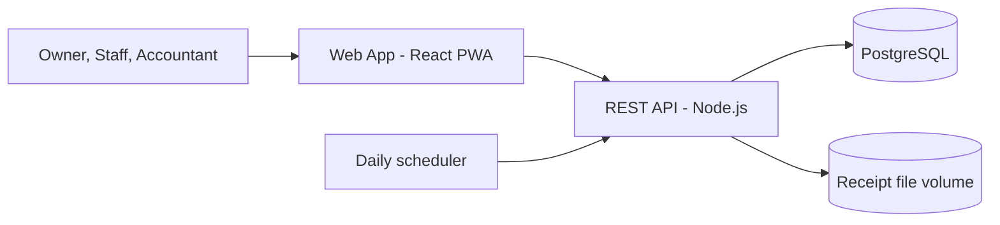
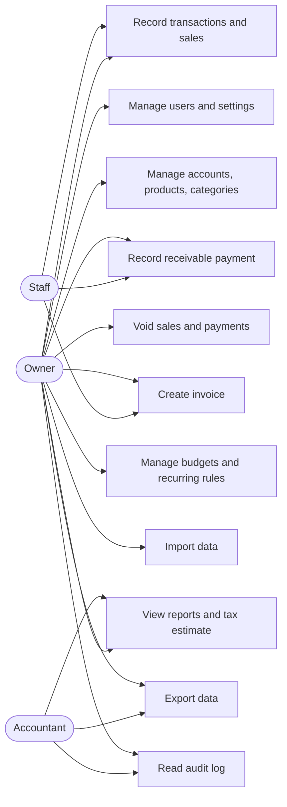
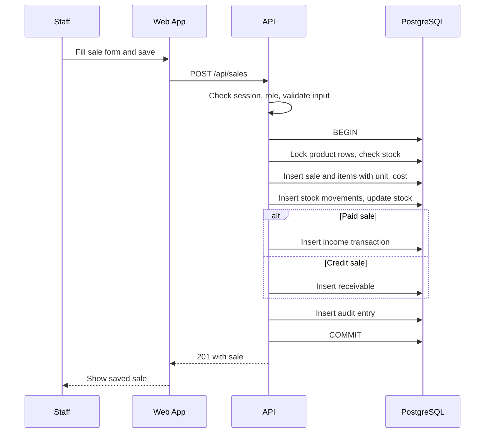

# SOFTWARE REQUIREMENTS SPECIFICATION (SRS)

> **Catatan:** Versi sederhana berbeda dari dokumen ini. Lihat `Docs/superpowers/specs/2026-11-04-usahaku-sederhana-design.md`.

**Product Name:** usahaku (bookkeeping and finance app for UMKM)  
**Document Version:** 1.0  
**Status:** Draft  
**Date:** 04 November 2026  
**Prepared By:** [To be decided: author name]  
**Reference Standard:** ISO/IEC/IEEE 29148  

---

# 1. Introduction

## 1.1 Purpose
This SRS states the software requirements of usahaku in testable form. It is written for the development team, QA, and the technical lead. It turns the PRD and FRD into "the system shall" statements with measurable targets.

## 1.2 Scope
The system is named **usahaku**. It is a web application that lets UMKM owners and their staff record sales, income, and expenses, track stock, receivables, and payables, issue invoices, and read profit and loss, cash flow, and tax estimate reports.

The system does not connect to banks or marketplaces, does not take online payments, does not run payroll, does not calculate VAT, does not read receipt photos with OCR, and does not work offline.

The benefit is that a small business owner can see real profit and unpaid bills without keeping a spreadsheet by hand.

## 1.3 Definitions, Acronyms, and Abbreviations
| Term | Definition |
|---|---|
| UMKM | Usaha Mikro, Kecil, dan Menengah, Indonesian micro, small, and medium enterprises |
| IDR | Indonesian rupiah, the only currency in version 1.0 |
| PWA | Progressive Web App |
| REST | Representational State Transfer, the API style used |
| TLS | Transport Layer Security |
| COGS | Cost of goods sold |
| RPO | Recovery point objective, the maximum data loss accepted |
| RTO | Recovery time objective, the maximum time to restore service |
| PPh Final UMKM | Final income tax for UMKM, a percentage of gross turnover |
| UU PDP | Indonesian Law No. 27 of 2022 on Personal Data Protection |

## 1.4 References
| Document | Version | Description |
|---|---|---|
| PRD | 1.0 | Product requirements, business rules, API list, schema |
| FRD | 1.0 | Functional requirements per module with flows and messages |

## 1.5 Document Overview
Section 2 describes the product, its users, and its limits. Section 3 lists the specific requirements: interfaces, functions, performance, database, design constraints, and quality attributes. Section 4 says how each requirement is verified. Section 5 holds the traceability matrix and supporting diagrams.

---

# 2. General Description

## 2.1 Product Perspective
usahaku is a standalone system. It has no connection to other systems. Users reach it through a browser. The API is the only component that reads or writes the database and the file volume.

## 2.2 Product Functions
- Registration, login, three roles, and user management.
- Business settings: period start day, taxpayer type, tax rate.
- Cash, bank, and e-wallet accounts with balances.
- Income, expense, and transfer transactions with categories, tags, receipt photos, and keyword rules.
- Product catalog, stock movements, and sales with automatic stock reduction.
- Contacts, receivables, payables, partial payments, and invoices as PDF.
- Monthly budgets and recurring transactions.
- Dashboard, five reports, and export to CSV, XLSX, and PDF.
- Monthly final income tax estimate.
- CSV and XLSX import, full data export, and audit log.

## 2.3 User Characteristics
| User | Skill Level | Frequency of Use | Notes |
|---|---|---|---|
| Owner | Basic. Uses a smartphone daily, little accounting training. | Daily | Needs plain Indonesian wording and few steps. |
| Staff | Basic. Often at a counter with one hand free. | Many times a day | Needs a fast sale screen on a phone. |
| Accountant | Intermediate to advanced in accounting. | Weekly or monthly | Needs exact figures, filters, and exports. |

## 2.4 General Constraints
- The system stores personal data of users and customers and must follow UU PDP.
- Tax values (rate and threshold) reflect the UMKM final tax rules (PP 55/2022) as understood at the time of writing and must be confirmed before release. They are editable settings.
- The UI language is Indonesian. Code, API fields, and documents are in English.
- The system must run on one VPS with 2 vCPU and 4 GB RAM.
- Supported browsers are the latest two versions of Chrome, Edge, Firefox, Safari, and Android Chrome.

## 2.5 Assumptions and Dependencies
- Each user belongs to exactly one business.
- All amounts are in IDR as whole rupiah.
- The API runs as one instance, so the scheduler runs once per day.
- Owners hand temporary passwords to new users in person, so no email service is needed.
- A public domain name and DNS are available for TLS.
- Users have an internet connection while recording data.

---

# 3. Specific Requirements

## 3.1 External Interface Requirements

### 3.1.1 User Interfaces
- All UI text is in Indonesian. Amounts show as `Rp1.250.000`. Dates show as `04 Nov 2026`.
- Layouts work from 360 px wide. Mobile uses a bottom navigation bar and a floating Add button. Desktop uses a top navigation bar.
- Every list and form has loading, empty, success, and error states.
- Destructive actions (void, archive, deactivate) ask for confirmation.
- Dialogs trap focus, return focus on close, and honor `prefers-reduced-motion`.
- Touch targets are at least 44 by 44 px.
- The app ships a web manifest and service worker so it can be installed. The service worker caches static files only, not API data.

### 3.1.2 Hardware Interfaces
- Phones, tablets, and computers with a supported browser.
- The camera or photo library, through the browser file picker, for receipt photos.
- No printers or barcode scanners in version 1.0. Printing uses the browser print function on the PDF.

### 3.1.3 Software Interfaces
| System / Component | Version | Purpose |
|---|---|---|
| PostgreSQL | 16 | Data storage |
| Node.js | 20 LTS | API runtime |
| Express | 4.x | HTTP server |
| React and Vite | 18 and 5 | Web app |
| PDFKit | Current stable | Invoice and report PDF |
| ExcelJS | Current stable | XLSX export and import parsing |
| Caddy | 2.x | Reverse proxy and TLS |
| Docker Compose | v2 | Deployment |

### 3.1.4 Communication Interfaces
- All traffic uses HTTPS with TLS 1.2 or newer on port 443. Port 80 redirects to 443.
- The API uses JSON over HTTP with UTF-8. File responses use `application/pdf`, `text/csv`, `application/vnd.openxmlformats-officedocument.spreadsheetml.sheet`, and `application/zip`.
- Uploads use `multipart/form-data`.
- Errors use `{ "error": { "code", "message", "fields" } }` with HTTP 400, 401, 403, 404, 409, or 422 as fitting.
- The database and the API container communicate on a private Docker network. PostgreSQL is not exposed to the internet.

## 3.2 Functional Requirements

| ID | Requirement | Description | Priority | Source |
|---|---|---|---|---|
| SRS-F-001 | Authentication | The system shall register a business with an Owner, log users in and out with a server-side session, lock an account for 15 minutes after 5 failed logins, and force a password change when `must_change_password` is true. | High | PRD FR-001 |
| SRS-F-002 | User & role management | The system shall let only the Owner create, edit, reset, and deactivate users, shall end a deactivated user's sessions immediately, and shall refuse to deactivate the last active Owner. | High | PRD FR-002 |
| SRS-F-003 | Business settings | The system shall store period start day (1 to 28), taxpayer type, tax rate, tax threshold, and invoice payment info, and shall use them in all later calculations. | Medium | PRD FR-003 |
| SRS-F-004 | Account management | The system shall compute each account balance as opening balance plus income and incoming transfers minus expense and outgoing transfers, and shall refuse to delete an account that has transactions. | High | PRD FR-004 |
| SRS-F-005 | Transaction recording | The system shall create, edit, soft delete, and list income, expense, and transfer transactions, shall reject transfers between the same account, and shall let Staff edit only their own transactions within 24 hours. | High | PRD FR-005 |
| SRS-F-006 | Categories, tags, auto-rules | The system shall suggest a category from the highest-priority keyword rule that matches the note, and shall not delete categories that have transactions. | Medium | PRD FR-006 |
| SRS-F-007 | Product & stock | The system shall keep stock as the sum of stock movements, shall never allow tracked stock below zero, and shall hide cost price and margin from Staff. | High | PRD FR-007 |
| SRS-F-008 | Sales recording | The system shall save a sale, its items, stock movements, and the income transaction or receivable in one database transaction, and shall reverse all of them when the sale is voided. | High | PRD FR-008 |
| SRS-F-009 | Contact management | The system shall keep customers and suppliers, show the outstanding balance per contact, and refuse to archive a contact with open debts. | Medium | PRD FR-009 |
| SRS-F-010 | Receivables & payables | The system shall record partial payments, update `paid_amount` and status, create the matching income or expense transaction, and reject a payment above the remaining balance. | High | PRD FR-010 |
| SRS-F-011 | Invoicing | The system shall create at most one invoice per sale, number it `INV/YYYY/NNNN` without gaps or reuse, and generate a PDF. | Medium | PRD FR-011 |
| SRS-F-012 | Budgets | The system shall keep one budget per business per period and shall report used amount, percentage, and remaining amount per expense category. | Medium | PRD FR-012 |
| SRS-F-013 | Recurring transactions | The system shall post each due recurring rule once per due date at 00:05 Asia/Jakarta and shall continue with other rules when one fails. | Medium | PRD FR-013 |
| SRS-F-014 | Dashboard | The system shall return role-specific dashboard data and shall return no profit, balance, or cost data to Staff. | High | PRD FR-014 |
| SRS-F-015 | Reports & export | The system shall produce profit and loss, cash flow, sales by product, expense by category, and receivable aging, shall exclude transfers and debt payments from profit, and shall export the same figures to CSV, XLSX, and PDF. | High | PRD FR-015 |
| SRS-F-016 | Tax estimate | The system shall compute monthly tax as rate times the month's taxable turnover, where taxable turnover applies the yearly threshold for individual taxpayers, rounded down to whole rupiah. | Medium | PRD FR-016 |
| SRS-F-017 | Data import | The system shall import up to 5,000 rows from a CSV or XLSX file of up to 5 MB, flag invalid and duplicate rows in a preview, and save the confirmed batch atomically. | Medium | PRD FR-017 |
| SRS-F-018 | Data export | The system shall export all business data as a ZIP of UTF-8 CSV files with header rows, for Owner and Accountant only. | Low | PRD FR-018 |
| SRS-F-019 | Audit log | The system shall write an append-only audit entry in the same database transaction as every data change, login, failed login, and role change, and shall never write passwords or tokens into it. | Medium | PRD FR-019 |

## 3.3 Performance Requirements

| ID | Requirement | Measurable Target |
|---|---|---|
| SRS-P-001 | Response time | 95% of list and save requests complete in under 500 ms, measured at the API with 100 concurrent users |
| SRS-P-002 | Report time | Profit and loss over 50,000 transactions completes in under 3 seconds |
| SRS-P-003 | Concurrent users | 100 users at the same time on the reference VPS without errors above 0.1% |
| SRS-P-004 | Data volume | 200,000 transactions per business without breaking SRS-P-001 and SRS-P-002 |
| SRS-P-005 | Page load | The dashboard becomes usable in under 3 seconds on a 4G connection |
| SRS-P-006 | Export time | A full data export of 200,000 transactions completes in under 60 seconds |
| SRS-P-007 | Import time | Import of 5,000 rows completes in under 15 seconds |

## 3.4 Database Requirements
- PostgreSQL 16, because the system needs transactions, foreign keys, and check constraints to keep money and stock consistent.
- Every business-owned table carries `business_id` and every query filters by it.
- Amounts are stored as `BIGINT` rupiah. Quantities are `NUMERIC(12,3)`.
- Multi-table writes run inside one database transaction at the default `READ COMMITTED` level, with row locks on the product and account rows being changed.
- Foreign keys use `ON DELETE RESTRICT`. Transactions are soft deleted. Sales, payments, and invoices are voided.
- Audit entries are kept for 2 years. Expired sessions are removed 30 days after expiry.
- Schema changes are made with versioned SQL migration files.

## 3.5 Design Constraints
- The API follows REST with JSON. Inputs are validated with Zod schemas on the server.
- Authorization middleware runs before every handler except register and login.
- Code is kept simple: no abstraction before it is needed, no fallback logic, and no backward compatibility layers unless requested.
- The system deploys with Docker Compose on one VPS. No other infrastructure is assumed.
- Receipt photos live on a disk volume. Object storage is not used in version 1.0.
- Tests use Vitest for the web app and `node:test` for the API.

## 3.6 Software Quality Attributes

| ID | Attribute | Requirement |
|---|---|---|
| SRS-Q-001 | Reliability | Monthly service uptime of at least 99.5%. After a failure the system restores from the latest backup with RPO of 24 hours and RTO of 4 hours. |
| SRS-Q-002 | Availability | The service is available 24 hours a day. Planned maintenance happens between 01:00 and 04:00 Asia/Jakarta and lasts under 30 minutes. |
| SRS-Q-003 | Security | Argon2id password hashing, HTTP-only Secure SameSite cookies, TLS 1.2 or newer, backend role checks on every endpoint, parameterized SQL, rate limiting on login (10 attempts per minute per IP), upload type and size checks, and an audit log. |
| SRS-Q-004 | Maintainability | Lint passes with zero errors. Each business rule has an automated test. Services have no function longer than 60 lines. The API writes structured logs with request id and no personal data in them. |
| SRS-Q-005 | Portability | Runs in any Linux environment with Docker Compose v2. Nothing depends on a specific cloud provider. |
| SRS-Q-006 | Usability | A new Owner records a first sale within 5 minutes of registering, with no training. Touch targets are at least 44 px. Text contrast meets WCAG 2.1 AA. All forms can be used with a keyboard. |

## 3.7 Other Requirements
- **Legal:** the system keeps and deletes personal data according to UU PDP. On written request, the Owner can have a business's data exported and permanently deleted.
- **Localization:** Indonesian UI, Rupiah format with dot thousands separators, Asia/Jakarta as the business time zone, and dates stored in UTC or as plain dates.
- **Data migration:** version 1.0 has no migration from other systems except the file import in SRS-F-017.
- **Training:** a short in-app guide (first sale, first invoice, reading profit) is provided. No separate training is required.
- **Backups:** daily database dump and receipt volume copy kept for 30 days, with a restore test every quarter.

---

# 4. Verification

| Requirement ID | Method | Description |
|---|---|---|
| SRS-F-001 | Test | Automated tests for register, login, lockout after 5 failures, and forced password change |
| SRS-F-002 | Test | Role tests for every user endpoint and a session-end test after deactivation |
| SRS-F-003 | Test | Unit tests for period boundaries with start days 1, 25, and 28 |
| SRS-F-004 | Test | Balance calculation tests with income, expense, and transfers |
| SRS-F-005 | Test | API tests for validation, transfer rules, soft delete, and the 24-hour Staff window |
| SRS-F-006 | Test | Rule matching tests for priority and ties |
| SRS-F-007 | Test | Stock movement tests, negative stock rejection, and a Staff response test for hidden cost |
| SRS-F-008 | Test | Atomicity test that forces a failure mid-save and checks nothing is stored. Void test for full reversal |
| SRS-F-009 | Test | Archive refusal with open debts |
| SRS-F-010 | Test | Partial payment, overpayment rejection, and status transitions |
| SRS-F-011 | Test | Numbering test with concurrent invoice creation. PDF content inspection |
| SRS-F-012 | Test | Budget usage calculation with excluded transactions and inventory categories |
| SRS-F-013 | Test | Scheduler test with a faked clock, including month-end and a failing rule |
| SRS-F-014 | Test | Dashboard response test per role |
| SRS-F-015 | Test | Report calculations against a hand-computed fixture. Screen-to-file total comparison |
| SRS-F-016 | Test | Tax tests for individual and company cases from the acceptance criteria |
| SRS-F-017 | Test | Import tests for mapping, duplicates, invalid rows, size limits, and batch rollback |
| SRS-F-018 | Inspection | Open the ZIP and check headers and encoding |
| SRS-F-019 | Test | Audit entry tests for each event type, and a rollback test when the entry cannot be written |
| SRS-P-001 | Test | Load test with 100 concurrent users on the reference VPS |
| SRS-P-002 | Test | Report timing on a 50,000-transaction dataset |
| SRS-P-003 | Test | Same load test, count errors |
| SRS-P-004 | Test | Seed 200,000 transactions and repeat SRS-P-001 and SRS-P-002 |
| SRS-P-005 | Test | Lighthouse run on a throttled 4G profile |
| SRS-P-006 | Test | Export timing on the 200,000-transaction dataset |
| SRS-P-007 | Test | Import timing with a 5,000-row file |
| SRS-Q-001 | Analysis | Uptime monitoring and a restore drill |
| SRS-Q-002 | Demonstration | Check the maintenance window procedure |
| SRS-Q-003 | Inspection | Security checklist review and a dependency audit. Penetration test of login and upload before release |
| SRS-Q-004 | Inspection | Lint and test coverage report in CI |
| SRS-Q-005 | Demonstration | Fresh install from the Compose file on a clean Linux host |
| SRS-Q-006 | Demonstration | Usability session with 5 UMKM owners, and an automated contrast and keyboard check |

---

# 5. Appendix

## 5.1 Traceability Matrix
| SRS ID | PRD ID | FRD ID | Test Case |
|---|---|---|---|
| SRS-F-001 | FR-001 | FR-001 | TC-001 |
| SRS-F-002 | FR-002 | FR-002 | TC-002 |
| SRS-F-003 | FR-003 | FR-003 | TC-003 |
| SRS-F-004 | FR-004 | FR-004 | TC-004 |
| SRS-F-005 | FR-005 | FR-005 | TC-005, TC-006 |
| SRS-F-006 | FR-006 | FR-006 | TC-007 |
| SRS-F-007 | FR-007 | FR-007 | TC-008 |
| SRS-F-008 | FR-008 | FR-008 | TC-009, TC-010 |
| SRS-F-009 | FR-009 | FR-009 | TC-011 |
| SRS-F-010 | FR-010 | FR-010 | TC-012 |
| SRS-F-011 | FR-011 | FR-011 | TC-013 |
| SRS-F-012 | FR-012 | FR-012 | TC-014 |
| SRS-F-013 | FR-013 | FR-013 | TC-015 |
| SRS-F-014 | FR-014 | FR-014 | TC-016 |
| SRS-F-015 | FR-015 | FR-015 | TC-017 |
| SRS-F-016 | FR-016 | FR-016 | TC-018 |
| SRS-F-017 | FR-017 | FR-017 | TC-019 |
| SRS-F-018 | FR-018 | FR-018 | TC-020 |
| SRS-F-019 | FR-019 | FR-019 | TC-021 |
| SRS-P-001 to SRS-P-007 | NFR-002, NFR-003 | Not applicable | Load tests |
| SRS-Q-001, SRS-Q-002 | NFR-006 | Not applicable | Restore drill |
| SRS-Q-003 | NFR-001, NFR-007 | Not applicable | Security review |
| SRS-Q-006 | NFR-005 | Not applicable | Usability session |

## 5.2 Supporting Diagrams

### Use Case Overview

### Sale Save Sequence

---

# Revision History

| Version | Date | Changes | Author |
|---|---|---|---|
| 1.0 | 04 November 2026 | Initial document | [To be decided: author name] |

# Approval

| Role | Name | Status |
|---|---|---|
| Product Owner | [To be decided] | Pending |
| Technical Lead | [To be decided] | Pending |
| QA Lead | [To be decided] | Pending |
